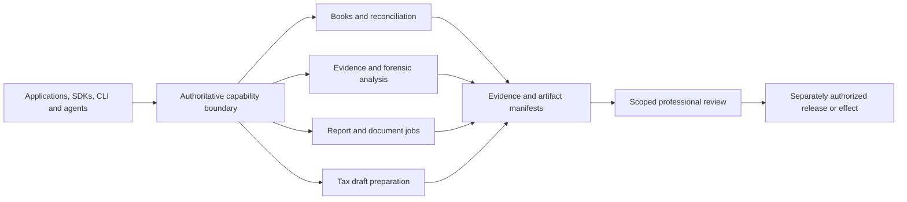

# Accounting workflow architecture

This is a sanitized architecture and workflow guide. The existing accounting reference system and the planned LedgerBank headless layer are distinct. This public repository contains documentation, not the private accounting engine or a deployed financial service.

This diagram is the intended integration contract. The reference application uses a React browser UI, Node/Express API and PostgreSQL; a separate Python/Beancount subsystem provides accounting and analysis source capabilities. Some reference views consume prepared artifacts rather than executing analysis on demand. Source availability is not service deployment or provider qualification.

The reusable concepts are engagement-scoped inputs, exact amounts, declared source coverage, findings linked to evidence, versioned report jobs, immutable artifact manifests and explicit review/effect states. A report can be prepared without being approved, published or filed. A draft PDF or contractor JSON is not an accepted agency return.

Rust is proposed for new typed contracts, validation, intent receipts and selected client/tool mechanisms. Existing Python and document workers can remain behind those contracts. No Rust runtime, public SDK release or tax filing capability is asserted by this guide.

See [tool contracts](TOOL-CONTRACT.md), [workpaper model](WORKPAPER-MODEL.md) and [tool catalog](TOOLS-CATALOG.md). Private implementation, internal operational findings and real customer evidence remain outside this public repository.
